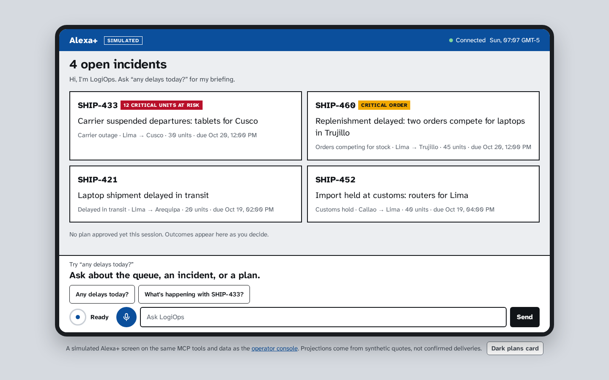
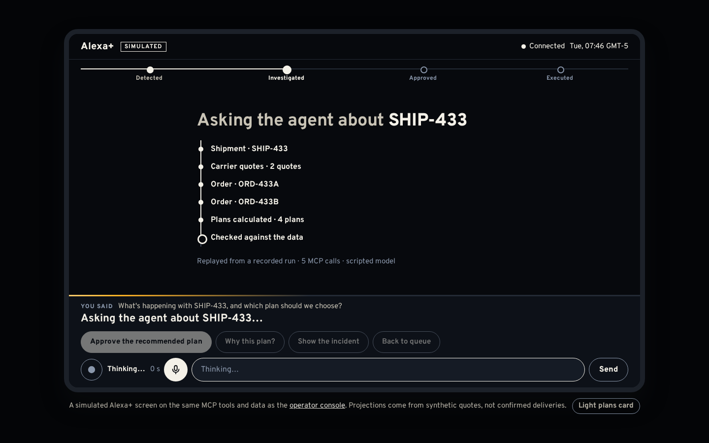
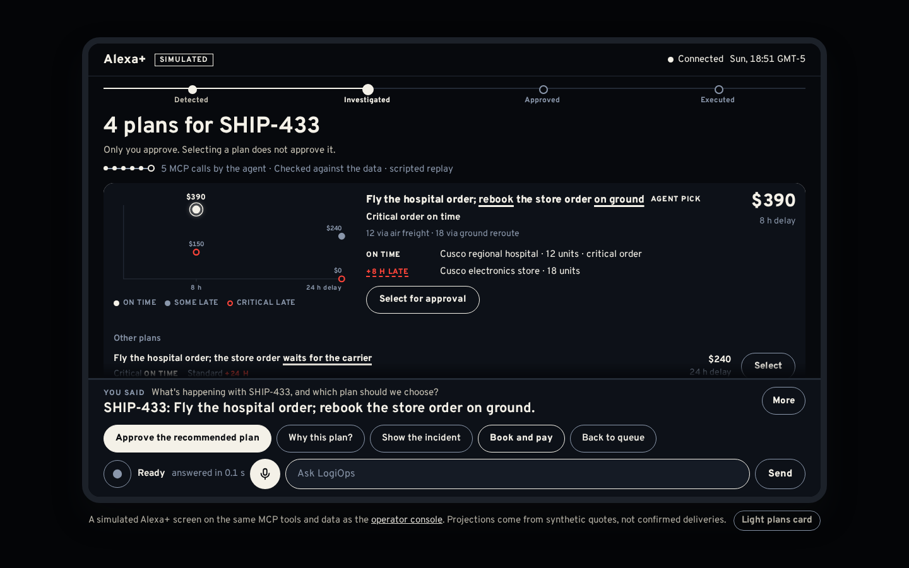
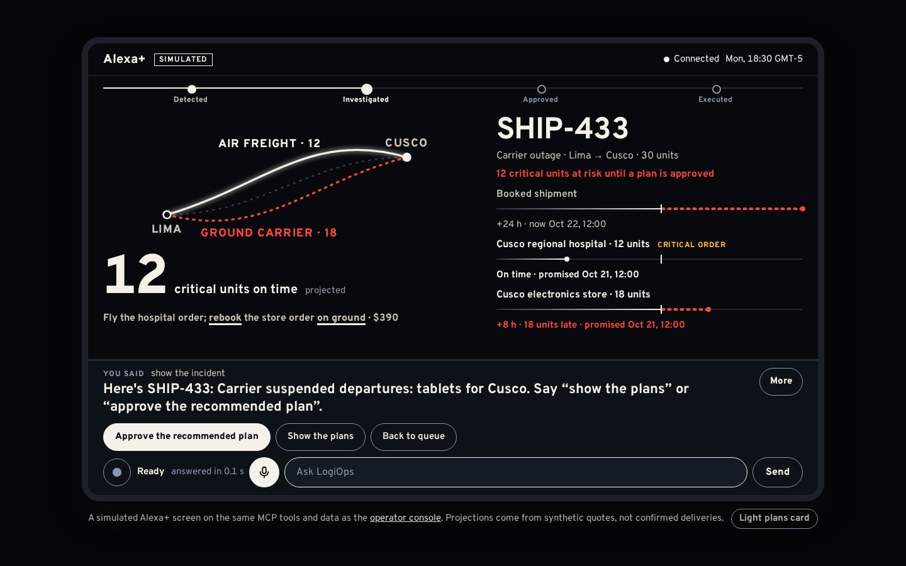
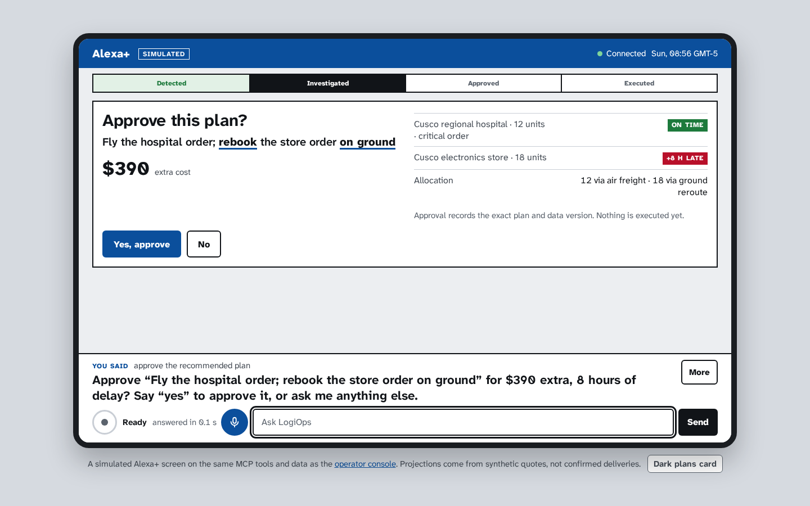
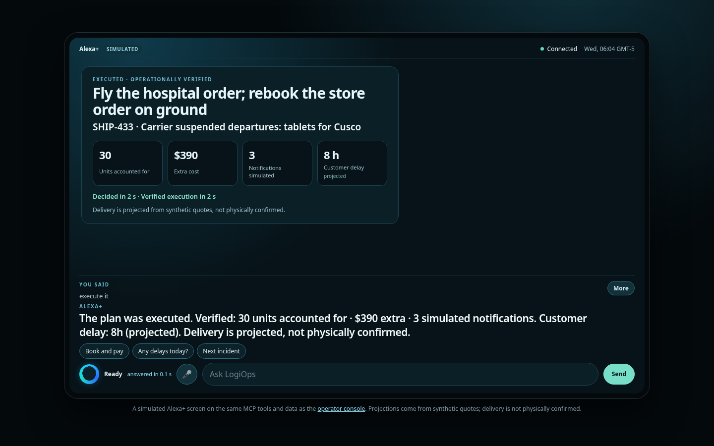
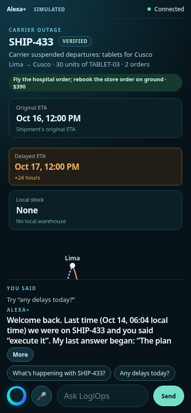
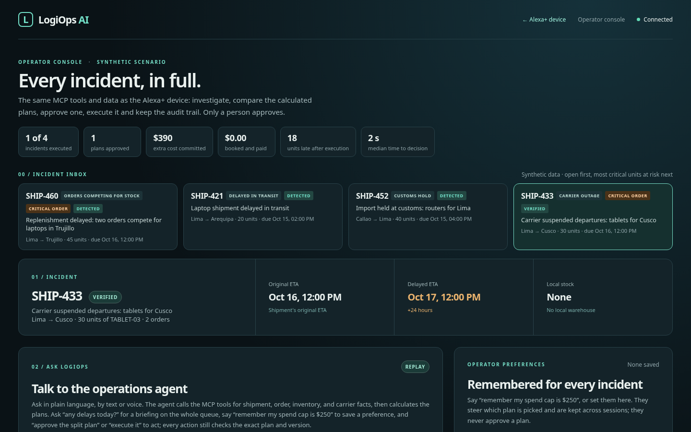

# LogiOps AI

**An operations desk you talk to**, on a simulated Alexa+ device over a real
self-hosted MCP server (Streamable HTTP, spec 2025-11-25, with an Agent Skill and
MCP Apps). Ask about a late shipment: an AI agent reads the orders, stock and
carrier quotes through MCP tools, code prices every feasible plan, and the agent
recommends one. You approve with one "yes"; the system executes the plan once
and verifies the result.

**The agent proposes. You approve. Code enforces it.**

[Live demo](https://dir4g4n7eq982.cloudfront.net/demo) ·
[Run it locally](#run-it-locally) · [How it works](#how-it-works) ·
[Reference](docs/reference.md)



| The agent at work | The plans, as an MCP App | The agent's pick |
|---|---|---|
|  |  |  |
| **Approve with one yes** | **The result, verified** | **On a phone** |
|  |  |  |

## What it does

- **Investigates.** The agent (Strands Agents on Amazon Bedrock) reads the
  incident through MCP tools; deterministic code calculates every feasible
  plan; the agent picks one by cost, arrival time and order priority, and says
  it in a sentence.
- **Checks itself.** Every answer, the spoken line included, is checked against
  the incident's data before it is shown.
- **Waits for a person.** No tool can approve. An approval names the exact plan
  and data version; a data change invalidates it and raises a proactive alert.
- **Executes and books once.** Execution is idempotent and verified; a booking
  reads its price back and is charged once, with a receipt.
- **Remembers.** A rule, a spend cap and a note steer the pick through fixed
  rules, and a signed-in person is welcomed back in the next session.

Two pages share one backend: `/demo`, a simulated Alexa+ device (voice, one card
at a time, the plans as an MCP App), and `/console`, the operator console.



**Who it is for (illustrative):** the exceptions desk of a regional distributor
that ships electronics and medical supplies to hospitals and stores. Four
synthetic incidents are built in, and a scenario pack brings your own. The same
pattern fits any desk where an agent proposes and a person decides: payments
operations, on-call incidents, returns.

## Measured on the deployed demo

Live Amazon Bedrock through Strands Agents, 2026-10-19, for the two-order
carrier outage SHIP-433:

| What | Measured |
|---|---|
| Question to grounded recommendation | 12.2 s, 5 MCP calls, one live agent run |
| Tool calls streamed to the device | first at 2.6 s, last at 5.7 s; the answer at 12.5 s |
| First investigation to verified execution | 13.1 s in a scripted walkthrough, with no human pause |
| Outcome | 12 critical units on time, 18 standard units 8 h late, $390 extra |
| Booking | $466.10 with tax, charged once |
| Cost of the run | about US$0.04 of Bedrock usage |

`GET /metrics` reports the times, outcomes, bookings, model calls and tokens per
incident and per session, from the recorded events. The answer and streaming
times are what the client measured through CloudFront.

## Run it locally

No AWS account needed: replay mode runs the same MCP calls with a scripted model
and zero tokens.

```sh
docker compose up --build
```

Open <http://127.0.0.1:8000/demo> for the device and
<http://127.0.0.1:8000/console> for the console. Try "Any delays today?",
"What's happening with SHIP-433?", "approve the recommended plan", "yes",
"execute it" and "book it". `uv run python scripts/rehearse_api.py` walks the
whole flow headless and prints PASS or FAIL.

Without Docker, with Python 3.12+ and [uv](https://docs.astral.sh/uv/):

```sh
uv sync --extra dev
LOGIOPS_AGENT_MODE=replay uv run uvicorn logiops.api:app --host 127.0.0.1 --port 8000
```

For the live agent, sign in with `aws login`, make sure the model profile
`global.anthropic.claude-sonnet-4-6` is available in `us-east-1`, and start the
server without `LOGIOPS_AGENT_MODE=replay`. Every setting is in the
[reference](docs/reference.md#settings).

## Use it from any MCP client

The device is one MCP client among many. With
[MCP Inspector](https://github.com/modelcontextprotocol/inspector) against the
deployed demo:

```bash
npx @modelcontextprotocol/inspector --cli https://dir4g4n7eq982.cloudfront.net/mcp \
  --transport http --method tools/list
npx @modelcontextprotocol/inspector --cli https://dir4g4n7eq982.cloudfront.net/mcp \
  --transport http --method tools/call --tool-name get_shipment --tool-arg shipment_id=SHIP-433
```

As a guest, the read tools answer; execute, quote and book refuse with `401` and
an OAuth 2.1 challenge (Amazon Cognito). Add
`--header "Authorization: Bearer <token>"` with the operator token from the
testing instructions to act as the operator.

## How it works

```text
 /demo  simulated Alexa+ device          /console  operator console
        |  REST  ·  MCP over Streamable HTTP (/mcp)  ·  OAuth 2.1 or bearer token
        v
 +------------------------------------------------------------------------------+
 |  FastAPI app: token or sign-in, scopes, per-viewer limits, no-store          |
 |  +--------------------------+   +-----------------------------------------+ |
 |  | MCP server: 12 tools, 2  |   | Workflow core + SQLite: incident        | |
 |  | prompts, incident:// and |-->| registry (built-ins + scenario packs),  | |
 |  | receipt:// templates,    |   | versioned plans, approvals bound to     | |
 |  | MCP App view, Agent      |   | plan + version, idempotent execution,   | |
 |  | Skill, URL elicitation   |   | bookings, alerts, preferences, metrics  | |
 |  +--------------------------+   +-----------------------------------------+ |
 |        ^ in-process MCP                                                      |
 |  +--------------------------+   +-----------------------------------------+ |
 |  | Agent on Strands Agents: |   | AWS: Bedrock Converse (+ prompt cache), | |
 |  | investigate, ask, brief; |   | AgentCore Memory, Polly, Cognito;       | |
 |  | data check + 1 revision  |   | replay mode: scripted model, 0 tokens   | |
 |  +--------------------------+   +-----------------------------------------+ |
 +------------------------------------------------------------------------------+
```

- The device is itself an MCP client over Streamable HTTP: `initialize`,
  `tools/list`, `tools/call` (its inbox and alerts) and `resources/read` (the
  plans card).
- The agent gets read and investigation tools only, and loads the
  [Agent Skill](skills/logiops-exception-desk/SKILL.md) over MCP at the start of
  every run.
- The plans card is an MCP App rendered through a sandbox proxy on a second
  origin, with [`mcp-apps-web-host`](https://github.com/aalvaropc/mcp-apps-web-host),
  the open-source library extracted from this project.
- The live demo runs on EC2 behind CloudFront, deployed with Terraform and
  Systems Manager ([infra/amazon](infra/amazon/README.md)).

More in [architecture.md](docs/architecture.md), and every feature, endpoint and
setting in the [reference](docs/reference.md).

## Hackathon submission

Built for the **Amazon Developer Hackathon**: Alexa+ track, AWS Builder and Open
Source mini challenges.

| Tag | Devpost | Live demo | Open-source library |
|---|---|---|---|
| `amazon-v1.0` (to be tagged on 2026-10-22) | _pending_ | <https://dir4g4n7eq982.cloudfront.net/demo> | [`aalvaropc/mcp-apps-web-host`](https://github.com/aalvaropc/mcp-apps-web-host), MIT |

| Requirement | Where it is |
|---|---|
| Alexa+: a self-hosted MCP server, spec 2025-11-25, Streamable HTTP | [`logiops/mcp_server.py`](logiops/mcp_server.py), served at `/mcp` |
| Alexa+: an Agent Skill | [`skills/logiops-exception-desk/SKILL.md`](skills/logiops-exception-desk/SKILL.md), served as an MCP resource and loaded by the agent |
| Alexa+: a simulated experience whose page is an MCP client | `/demo`; its MCP client is [`logiops/static/app/mcp.js`](logiops/static/app/mcp.js) |
| Alexa+ creative uses: MCP Apps, state across sessions, purchasing | [the reference](docs/reference.md#interactive-plan-card-mcp-apps) |
| AWS Builder: Bedrock, Strands Agents, AgentCore Memory, Polly, Cognito | [`docs/architecture.md`](docs/architecture.md), [`infra/amazon/`](infra/amazon/README.md), [product feedback](docs/hackathon/amazon-feedback.md) |
| Open Source: a new MIT library made during the hackathon | [`aalvaropc/mcp-apps-web-host`](https://github.com/aalvaropc/mcp-apps-web-host) |
| Product feedback, friction log, feature requests | [`docs/hackathon/`](docs/hackathon/amazon-feedback.md) |

The live demo stays up until judging ends (20 Nov 2026). It shares a
daily budget of 40 model calls; when it is spent, or the model service is down,
replies come from the scripted replay and say so. The operator token is in the
private testing instructions. For judges:
[testing instructions](docs/hackathon/testing-instructions.md),
[decisions](docs/hackathon/decisions.md) and
[Alexa+ readiness](docs/hackathon/alexa-plus-readiness.md).

## License

MIT, see [LICENSE](LICENSE). The pages use the Overpass typeface under the SIL
Open Font License 1.1 ([OFL.txt](logiops/static/fonts/OFL.txt)).
